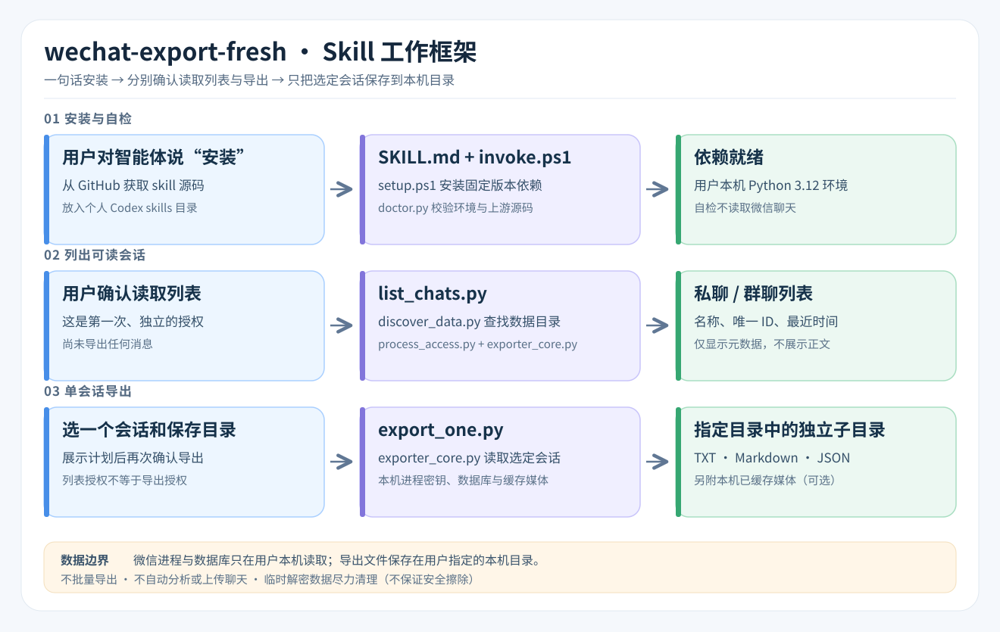

# 微信会话导出（Codex Skill）

在 64 位 Windows 本机发现微信数据，列出有本地消息表的私聊和群聊；分别确认后，仅将选定的一个会话导出为 TXT、Markdown、JSON 和本机已缓存的媒体。**不会自动分析、批量导出或上传聊天内容。**



## 使用场景：把聊天记录变成工作成果

例如，项目群里分散着需求变更、客户反馈和任务安排。你可以先让这个 skill **列出本机可读的会话**，选定一个项目群并确认导出到指定目录；之后，**再单独决定是否让 AI 读取导出的文件**，请它整理决策、待办、待确认问题，或起草周报和回复草稿。

导出完成后，可以这样对 AI 说：

> 请读取我刚导出的这个项目群的 `chat_full_for_llm.md`，整理项目决策、待办事项（只填写聊天里明确提到的负责人和截止时间）、待确认问题，并起草一份周报。每项结论注明对应日期或消息依据；不确定的标为“待核实”。先不要发送消息或修改其他系统。

**边界：**skill 只负责在分别确认后导出选定的本机会话，不会自动把聊天交给 AI 分析。让 AI 读取导出文件是另一步操作；工作群可能包含同事、客户或商业敏感信息，使用前请确认有权处理，并按组织规定选择 AI 服务、必要时先脱敏。AI 生成的结论仍需人工核对。

## 一句话安装（Codex）

在能够访问 GitHub、安装本地 Codex skills 的智能体对话中，直接说：

> 请帮我安装这个 Codex skill：https://github.com/niouoklul/wechat-chat-export 。`SKILL.md` 在仓库根目录，技能名称是 `wechat-export-fresh`。安装后运行 `doctor` 自检并告诉我结果；如果已有同名技能，请先问我再覆盖。

由智能体下载并放入个人 skills 目录即可，不必手动复制文件。**但安装不等于免环境配置**：运行聊天列表与导出需要 64 位 Windows、已安装的 64 位 Python 3.12，以及首次通过 pip 安装依赖时的网络连接。缺少条件时，智能体应说明缺什么，而不是声称安装完成即可导出。安装完成后可在下一轮对话使用 `$wechat-export-fresh`。

`doctor` 检查依赖和脚本入口，不读取微信消息或进程。以后通过 `$wechat-export-fresh` 请求列出会话或导出，模型会分别询问列表授权、目标及输出位置、导出授权。参见 [使用说明](references/usage.md)。

## 来源与限制

核心导出和数据目录发现源码来自 [wechat-chat-export](https://github.com/zhuzhangxue/wechat-chat-export)，固定参考其 v1.4.0 提交 `2c49469a91e2f3b0c73a581e15a8ad2db25b7923`，并用 `scripts/upstream_source.json` 校验两份上游源码散列；本 skill 的入口脚本限制为单会话、两次确认和指定本机输出目录。列表与导出使用同一套“存在本地消息表且身份可确认”的判定：只有 session 缓存、没有 contact 条目的会话也能按唯一标识导出；未聊天的普通联系人不会误入导出。底层数据库库固定为 `wechatauto-replica==1.2.4.4`，通过 pip 安装。上游项目采用 Apache-2.0 许可证，详见 [LICENSE](LICENSE) 和 [第三方说明](THIRD_PARTY_NOTICES.md)。

默认只取本机已缓存的图片、文件、语音、视频。没有安装语音转换器时会保留本机可读的 SILK 原始语音，不会为此下载可执行文件；不下载语音识别模型、不转录。未同步或未缓存的内容无法恢复。临时解密文件会尽力清理，**不等于安全擦除**。导出文件是明文，需由使用者妥善保管。

```powershell
python -X utf8 .\scripts\build\check_release.py
```


